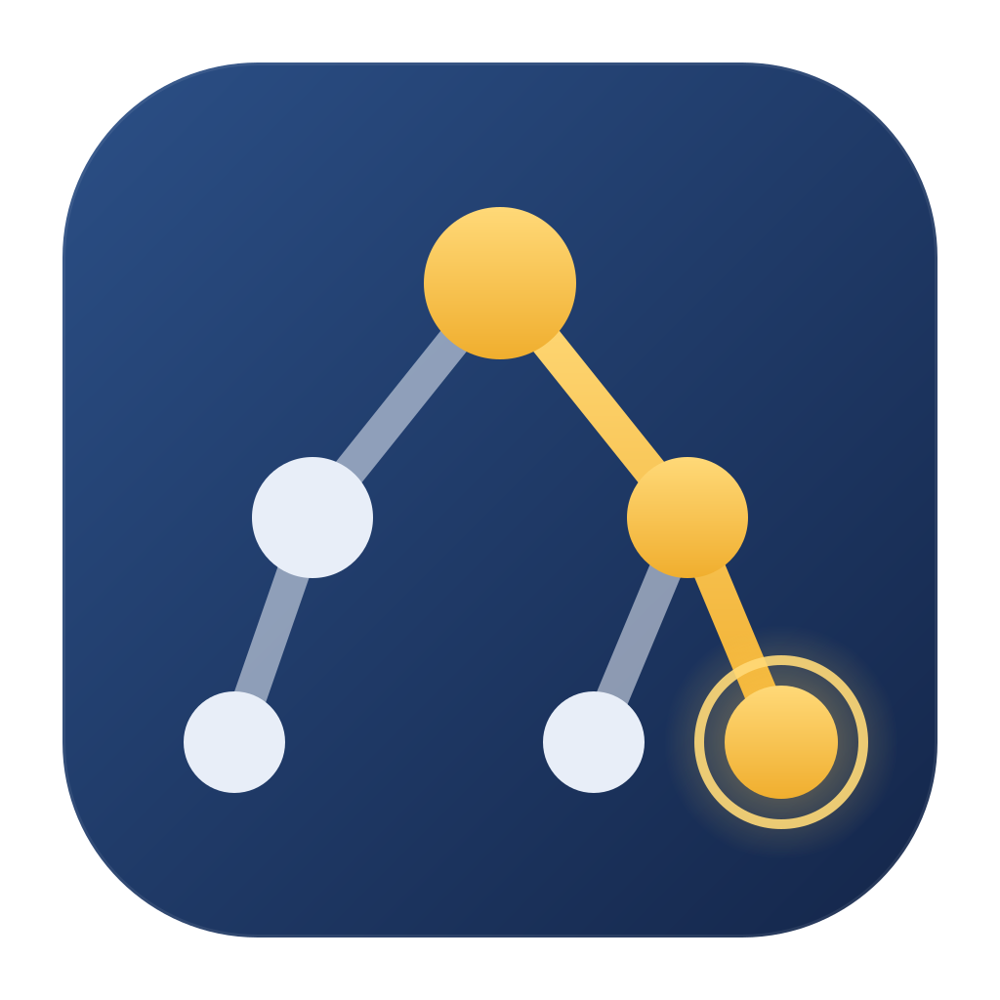
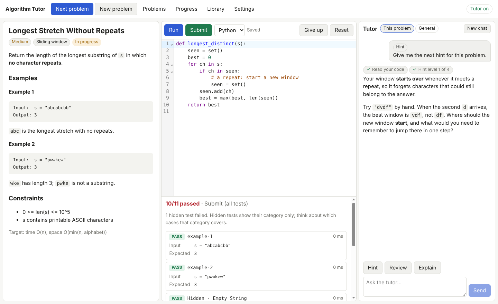
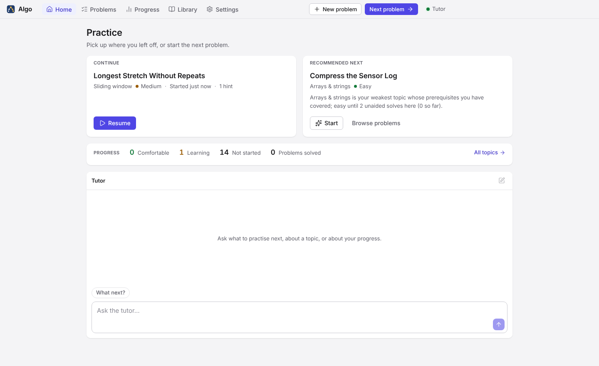
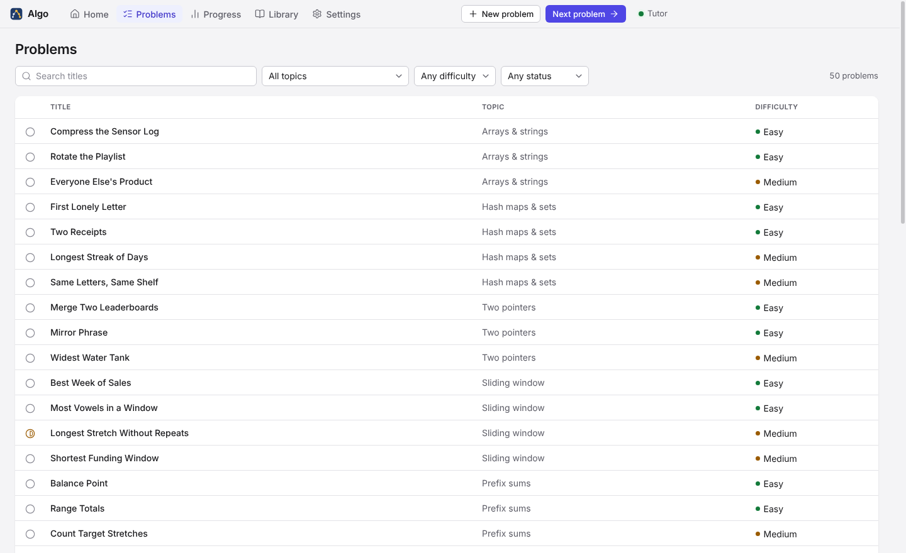
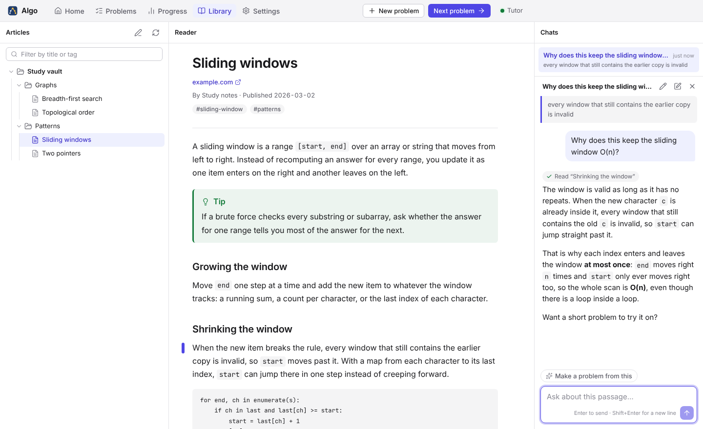
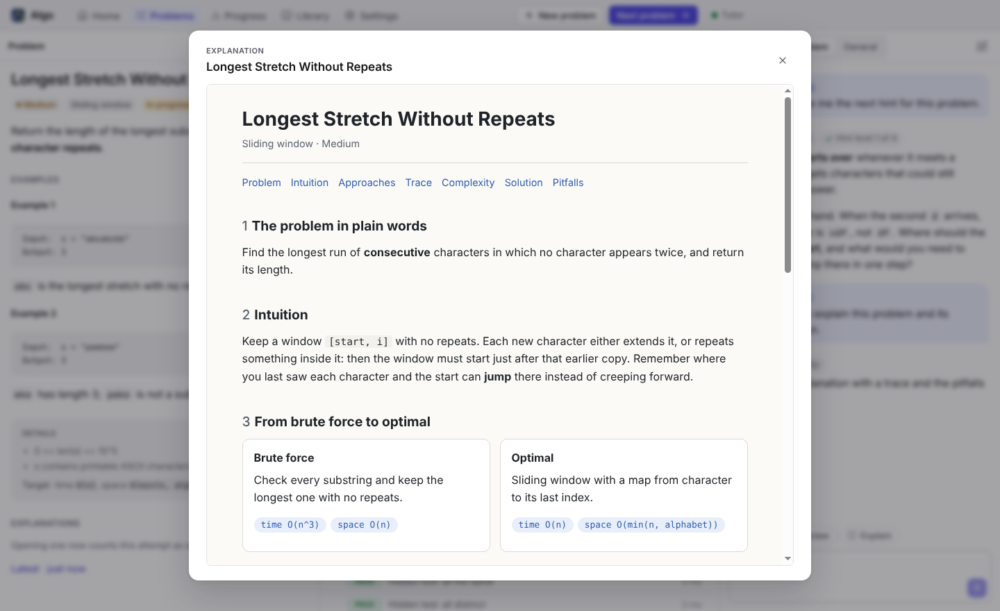
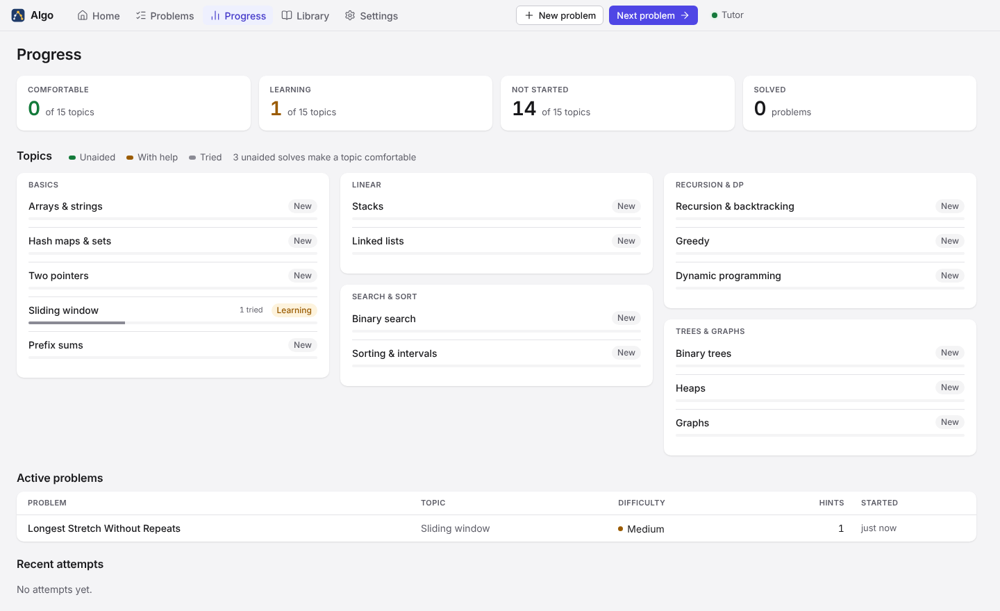
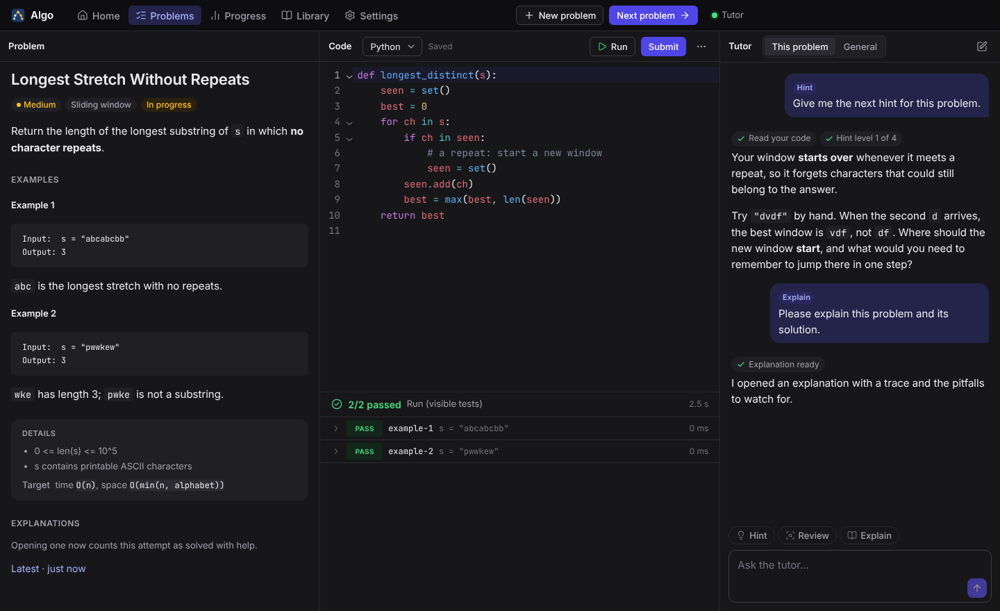
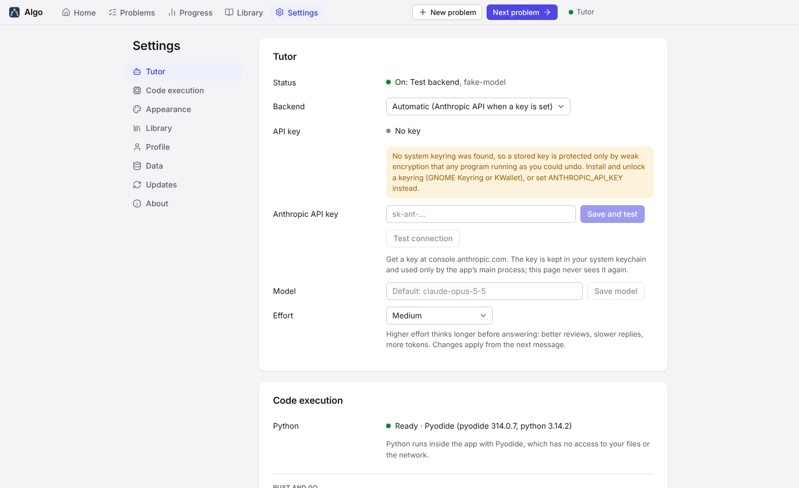

<div align="center">



# Algo

**Practise data structures and algorithms with an AI tutor.**<br>
It hints, reviews and explains. Real tests decide pass or fail.

[](https://github.com/hqazi/algo/actions/workflows/ci.yml)
[](LICENSE)


[**Download**](https://github.com/hqazi/algo/releases) ·
[**Documentation**](docs/README.md) ·
[**Screenshots**](#screenshots) ·
[**Contributing**](CONTRIBUTING.md)

<br>



</div>

> [!NOTE]
> **Status: v0.1.0 release candidate.** Builds are not code-signed yet, so your
> OS warns the first time you open the app;
> [Installation](docs/guide/installation.md) shows the one-time step for each
> OS.

## Why Algo?

Most practice sites either hand you the answer or leave you alone with a red
"wrong answer". Algo sits in between: a desktop app with the
problem, an editor, a test runner and a tutor side by side, that helps you get
unstuck one step at a time and never takes your word, or the model's, for
whether a solution works.

### 🧩 Practice that tells the truth

- **50 curated problems** across 15 topics, from arrays and hashing to graphs
  and dynamic programming, each with visible examples and hidden tests.
- **Run** checks the examples; **Submit** runs every test. Hidden tests report
  only their category ("repeat inside the window"), so you still have to
  think.
- **Pass or fail always comes from running the tests**, never from the model.
- **Next problem** picks what to practise from your levels per topic, and
  **Progress** shows where you stand.

### 🧑‍🏫 A tutor that teaches instead of telling

- **Hints one level at a time**, from a nudge to a near-solution, written for
  the code you actually have.
- **Reviews** that run the tests first, then look at complexity, edge cases
  and readability.
- **Explanation pages**: plain words, intuition, brute force to optimal, a
  step-by-step trace, complexity and pitfalls.
- **New problems** on demand: generate one, paste a statement, or import from
  an open problem set. Each appears only after its reference solution passes
  its own tests.
- Use an **Anthropic API key** or your installed **Claude Code**.

### 📚 A library for what you read

- Point the app at your **Markdown notes or Obsidian vault** and read clipped
  articles offline, images included.
- **Select a passage and ask about it.** Each article keeps several chats,
  each pinned to its passage with a marker in the margin.
- Turn a passage into a **practice problem**, or ask the tutor to **write an
  article** for you.

### 🔒 Private and sandboxed by design

- **Works without AI.** Browsing, editing, running, submitting, progress and
  reading need no key.
- **Your Python runs in a sandbox** (in-app [Pyodide](https://pyodide.org)) with
  no file or network access, and so does any code the tutor writes. Rust and
  Go run with your own toolchains, or isolated in Docker or Podman.
- **Your API key stays in your OS keychain.** No telemetry, no accounts.
  [Exactly what the tutor sees](docs/guide/data-and-privacy.md#privacy-what-the-tutor-sees)
  is documented.
- **One installer, settings in the app, updates itself.** Your progress lives
  in one folder you can export.

## Screenshots

<table>
  <tr>
    <td width="50%"></td>
    <td width="50%"></td>
  </tr>
  <tr>
    <td align="center"><b>Home</b>: carry on, or take the next pick</td>
    <td align="center"><b>Problems</b>: 50 curated, more on demand</td>
  </tr>
  <tr>
    <td width="50%"></td>
    <td width="50%"></td>
  </tr>
  <tr>
    <td align="center"><b>The Library</b>: chat about a passage of your notes</td>
    <td align="center"><b>Explanations</b>: from brute force to optimal</td>
  </tr>
  <tr>
    <td width="50%"></td>
    <td width="50%"></td>
  </tr>
  <tr>
    <td align="center"><b>Progress</b>: a level for every topic</td>
    <td align="center"><b>Dark mode</b>: follows your system</td>
  </tr>
  <tr>
    <td width="50%"></td>
    <td width="50%"></td>
  </tr>
  <tr>
    <td align="center"><b>Settings</b>: every option in one place, applied at once</td>
    <td></td>
  </tr>
</table>

## Quick start

1. **Download** the installer for your OS from the
   [Releases page](https://github.com/hqazi/algo/releases): `.dmg` for macOS
   (Apple silicon or Intel), `.exe` for Windows, `.deb` or `.AppImage` for
   Linux. Nothing else is needed to practise in Python.
2. **Open it** once past your OS's warning about unsigned apps
   ([how, per OS](docs/guide/installation.md)).
3. **Answer five questions** (or skip them), optionally
   [connect the tutor](docs/guide/tutor.md#connecting-the-tutor), and press
   **Next problem**.

## Documentation

| | |
|---|---|
| 📦 [Installation](docs/guide/installation.md) | Per-OS install steps and updates. |
| 🚀 [Getting started](docs/guide/getting-started.md) | First run, practising, progress, new problems. |
| 🧑‍🏫 [The tutor](docs/guide/tutor.md) | API key or Claude Code; hints, reviews, explanations. |
| 📚 [The Library](docs/guide/library.md) | Reading your articles and chatting about passages. |
| ⚙️ [Code execution](docs/guide/code-execution.md) | Python's sandbox, Rust and Go, containers. |
| 🔐 [Your data and privacy](docs/guide/data-and-privacy.md) | Backups, and what is sent where. |
| 🩺 [Troubleshooting](docs/guide/troubleshooting.md) | Common problems and fixes. |

## Development

You need Node.js 22. Then:

```bash
npm start
```

This installs the dependencies when they are missing or out of date
(`npm ci`) and opens the app in development mode. On Linux it uses X11
(XWayland), because under Wayland the window may never appear; set
`ALGO_OZONE_PLATFORM=wayland` to try Wayland. `npm run dev` starts the app
without those steps.

The app is Electron + React + TypeScript, with the tutor's logic in a pure
`packages/core` and Python running in Pyodide. Start with
[Architecture](docs/architecture.md), then [Contributing](CONTRIBUTING.md) for
the checks and ground rules. The full [specification](docs/SPEC.md) and the
[decision log](docs/DECISIONS.md) explain why things are the way they are.

## Acknowledgements

Algo is the successor to
[`dsa-tutor`](https://github.com/hqazi/dsa-tutor), whose teaching model,
problems and interface it carries forward. It is built on
[Electron](https://www.electronjs.org), [React](https://react.dev),
[CodeMirror](https://codemirror.net), [Pyodide](https://pyodide.org) and the
[Anthropic TypeScript SDK](https://github.com/anthropics/anthropic-sdk-typescript).
Imported problems come from [Exercism](https://exercism.org)'s openly licensed
problem specifications.

## License

[Apache License 2.0](LICENSE).
