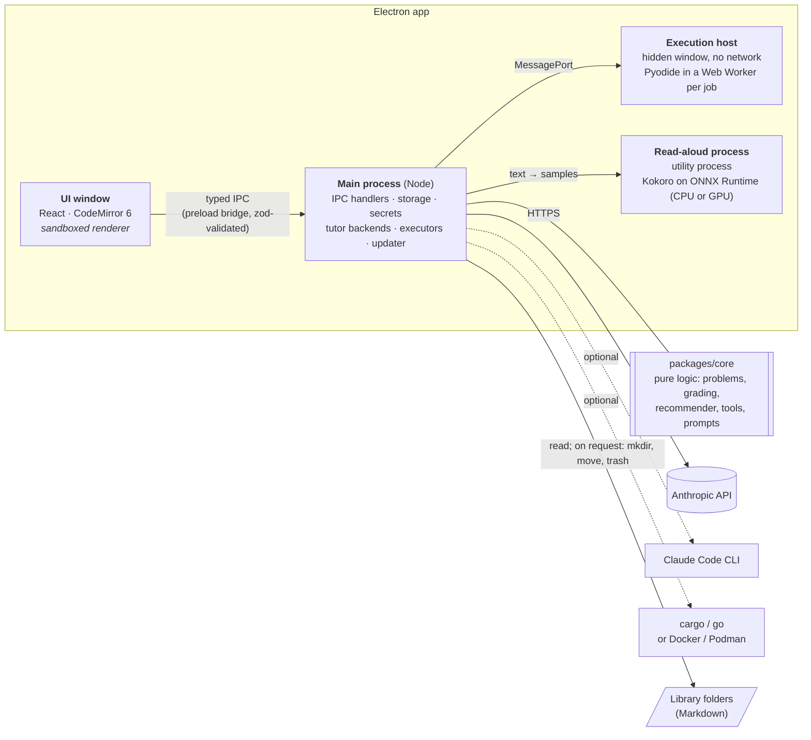
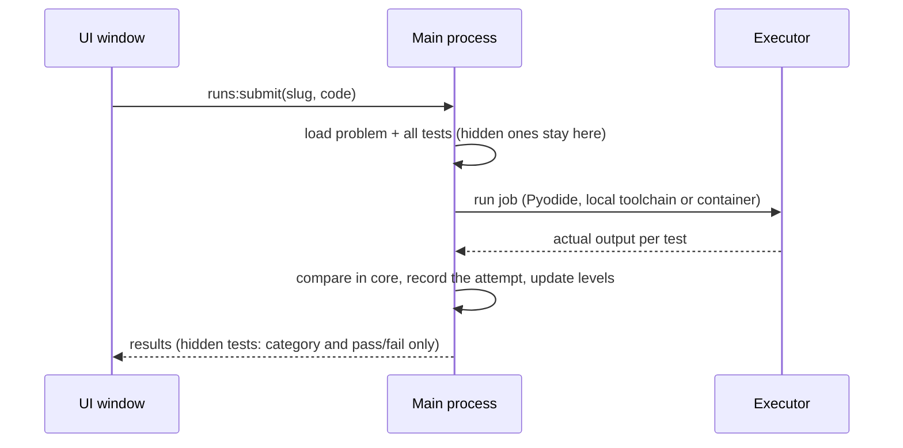

# Architecture

A short tour of how Algo is put together. The full contract is
[`SPEC.md`](SPEC.md); the reasons behind each choice are in
[`DECISIONS.md`](DECISIONS.md).

## The big picture

- **The UI** never touches Node, files or the network. It talks to the main
  process only through a typed `window.tutor` bridge; every message is
  validated with `zod`. It is served over the app's own `tutor-app://`
  protocol with a strict Content Security Policy.
- **The main process** owns everything privileged: the SQLite database, the
  API key (in the OS keychain), the tutor backends, code execution and the
  Library's file and image access.
- **The execution host** is a hidden, sandboxed, network-blocked window that
  runs Python in [Pyodide](https://pyodide.org). The user's Python and any
  code the model writes run only here.
- **The read-aloud processes** (`main/tts/`) are two Electron utility
  processes, started on the first chunk the reader asks for and stopped
  when idle. One runs eSpeak NG, which is downloaded with the voice (it is
  GPL-3.0, so not part of the app) and only turns text into phonemes. The
  other runs the Kokoro voice model with onnxruntime-node, on the CPU or, when
  Settings turns it on, the GPU, and only turns text into audio samples.
  The model is downloaded once, on request, by the main process.
- **`packages/core`** is pure TypeScript with no Electron or Node-only
  imports: problem schema and validation, test comparison, the recommender and
  levels, the hint ladder, tutor tools and the system prompt. Storage,
  executors and time are injected, so another shell could reuse it.

## How a Submit works

Pass or fail always comes from running the tests. The tutor sees the same
redacted results the UI does.

## How the tutor works

The tutor is a tool-using model. The main process builds the system prompt
from `content/references/` (topics, hint ladder, review rubric, problem spec)
and gives the model a fixed set of tools, such as `read_solution`,
`run_tests`, `take_hint`, `render_explanation`, `create_problem`, and, in
the Library, `read_article_section` and `search_article`. None of them write
the user's code, open arbitrary files, run commands or reach the network.

Two backends implement the same interface:

- **Anthropic API** through the official TypeScript SDK.
- **Claude Code**, run in bare mode with all of its own tools off. The
  tutor's tools are served to it over MCP, and the API key reaches it only as
  a short-lived token for a loopback relay.

Tests never call a real provider: `ALGOTUTOR_FAKE_TUTOR` replays scripted
turns (see `apps/desktop/e2e/fake-tutor*.json`).

## Repository layout

| Path | What |
|---|---|
| `packages/core/` | Pure logic shared by everything. No Electron, no Node-only modules. |
| `apps/desktop/src/main/` | Electron main process: windows, IPC, storage, secrets, executors, tutor backends, Library, updater. |
| `apps/desktop/src/preload/` | The only bridge between UI and main. |
| `apps/desktop/src/renderer/` | The React UI. |
| `apps/desktop/src/exec-host/` | The execution host page and Pyodide worker. |
| `apps/desktop/src/shared/` | IPC channel and settings types shared by main, preload and renderer. |
| `apps/desktop/e2e/` | Playwright-for-Electron end-to-end tests and the screenshot script. |
| `apps/desktop/packaging/` | electron-builder wrapper, fuses, packaged-app smoke test. |
| `content/problems/` | 50 curated problems in format v2: `problem.md`, `meta.json`, `tests.json`, `reference.py`. |
| `content/references/` | The teaching material the system prompt is built from. |
| `content/runners/` | Test harnesses for Python, Rust and Go. |
| `content/schema/` | JSON Schemas for the problem format (generated by `npm run schema:export`). |
| `runner-image/` | The container image for sandboxed Rust and Go. |
| `scripts/` | Content validation, schema export, the `dsa-tutor` converter. |

## Where data lives

| What | Where |
|---|---|
| Progress, attempts, chats | `tutor.db` (SQLite via `node:sqlite`, versioned migrations) |
| Preferences | `settings.json` (validated, unknown keys kept) |
| API key | OS keychain via Electron `safeStorage` |
| Solutions | `workspace/<slug>/solution.<ext>`, plain files the user can edit |
| New problems, explanations, tutor-written articles | Folders in the data directory |
| Downloaded article images | `cache/article-images/` (not exported) |
| The read-aloud voice model | `cache/kokoro-v1.0/` (not exported) |

See [SPEC §4](SPEC.md#4-data-and-settings) for the details.
