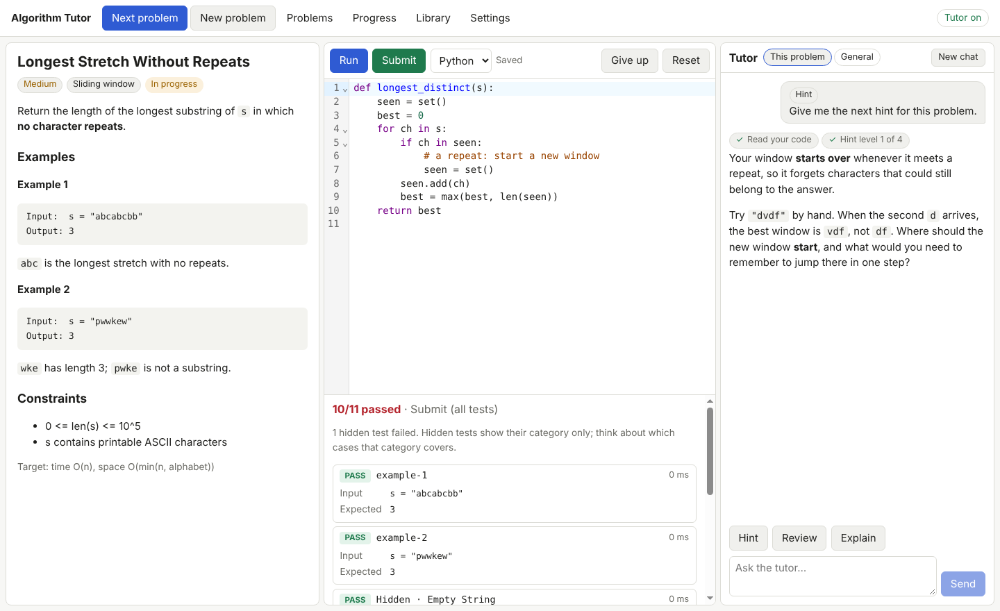

# Getting started

## First run

1. **Welcome.** Five short questions: your goal, your experience, how
   comfortable you are with each area, whether you want hints early or to
   struggle first, and a topic to focus on. **Use defaults and start** skips
   them; you can change every answer later in **Settings → Profile**.
2. **Connect the tutor** (optional). Paste an Anthropic API key, or skip:
   everything except the tutor chat and making new problems works without
   one. See [The tutor](tutor.md).
3. **Practise.** **Next problem** picks one for you.

## Practising

The practice view puts the problem, a code editor with the test results
under it, and the tutor side by side.

| Action | What it does |
|---|---|
| **Run** (Ctrl+Enter, or Cmd+Enter on macOS) | Runs your solution against the visible tests (the examples). |
| **Submit** | Runs every test, including hidden ones, and records the attempt. A hidden test shows only its category (for example "repeat inside the window"), never its input. |
| **Hint** | The next hint, one level at a time, from a nudge to a near-solution. |
| **Review** | The tutor runs the tests and reviews your solution. |
| **Explain** | A full explanation page: plain words, intuition, brute force to optimal, a trace, complexity, a solution and pitfalls. Opening one counts the attempt as solved with help. |
| **Give up** | In the **More** menu (…) beside **Submit**. Runs the tests one last time, records the attempt (with optional notes for later) and opens the reference solution. Once an attempt is recorded, it becomes **Reference**. |
| **Reset** | In the **More** menu. Replaces your code with the starter. |

Pass or fail always comes from running the tests, never from the model.

Your solution is a plain file (its path is shown in the practice view). You
can edit it in your own editor too: the app reloads it when it changes on
disk.

## What to practise next

**Next problem** stays on your focus topic until you are comfortable with it,
then moves to the weakest topic whose prerequisites you have. It starts with
easy problems and moves to medium after two unaided solves. **Problems**
lists every problem by topic, and the home screen's chat can answer "what
should I practise next?" when the tutor is on.

The app ships with 50 curated problems across 15 topics, from arrays and
hashing to graphs and dynamic programming.

## Progress

**Progress** shows your level per topic and your recent attempts. A topic is
*new*, *learning* once you have attempted it, and *comfortable* after three
different problems solved without hints. Hints and explanations still count,
as "solved with help".

## New problems

With the tutor on, **New problem** adds problems three ways:

- **Generate**: pick a topic, a difficulty and optionally an idea.
- **Paste**: paste a problem statement you have; the tutor turns it into a
  problem with tests.
- **Import**: from an openly licensed problem set (Exercism).

Every new problem passes a self-check before it appears: the tutor's reference
solution must pass its own tests in the sandbox. You can also make a problem
from a passage you are reading in the [Library](library.md).

## Settings

Every setting applies without a restart:

| Section | What is there |
|---|---|
| **Tutor** | API key, backend, model and effort. |
| **Code execution** | Python, Rust and Go runners, container runtimes and the runner image. See [Code execution](code-execution.md). |
| **Library** | Article folders, image downloads and the image cache. |
| **Appearance and editor** | Light, dark or system theme; editor font size and keys. |
| **Profile** | Your onboarding answers and focus topic. |
| **Data** | The data folder, export, import and reset. See [Your data](data-and-privacy.md). |
| **Updates** | Automatic checks and the update channel. |
