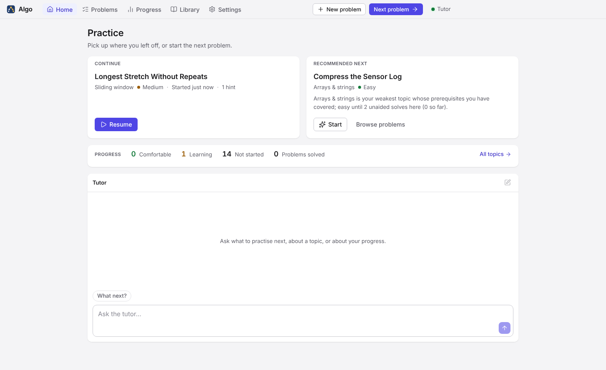
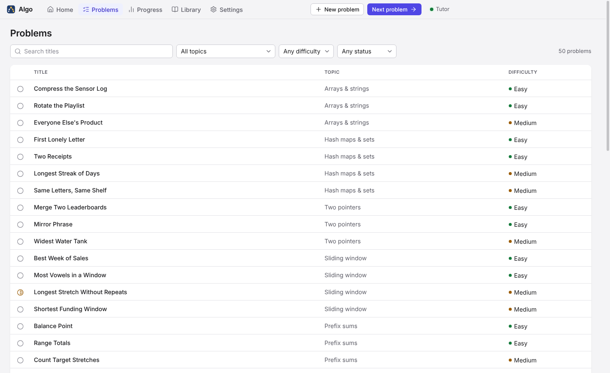
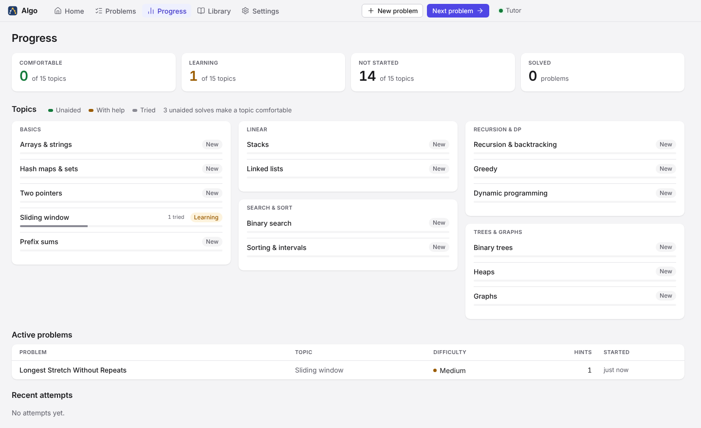
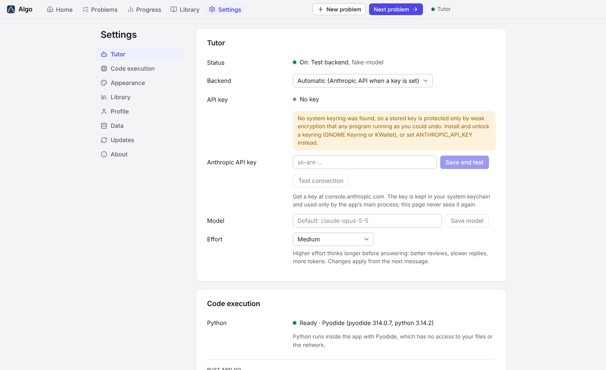

# Getting started

## First run

1. **Welcome.** Five short questions: your goal, your experience, how
   comfortable you are with each area, whether you want hints early or to
   struggle first, and a topic to focus on. **Use defaults and start** skips
   them; you can change every answer later in **Settings → Profile**.
2. **Connect the tutor** (optional). Paste an Anthropic API key, or skip:
   everything except the tutor chat and making new problems works without
   one. See [The tutor](tutor.md).
3. **Practise.** **Next problem** picks one for you.

The navigation sits in the window's title bar: **Home**, **Problems**,
**Progress**, **Library** and **Settings** on the left (icons only in a
narrow window), **New problem** and **Next problem** on the right, and the
tutor's status (a green dot when it is on; hover it for the backend and
model).

## Practising

The practice view puts the problem, a code editor with the test results
under it, and the tutor side by side.

| Action | What it does |
|---|---|
| **Run** (Ctrl+Enter, or Cmd+Enter on macOS) | Runs your solution against the visible tests (the examples). |
| **Submit** (Ctrl+Shift+Enter, or Shift+Cmd+Enter) | Runs every test, including hidden ones, and records the attempt. A hidden test shows only its category (for example "repeat inside the window"), never its input. |
| **Hint** | The next hint, one level at a time, from a nudge to a near-solution. |
| **Review** | The tutor runs the tests and reviews your solution. |
| **Explain** | A full explanation page: plain words, intuition, brute force to optimal, a trace, complexity, a solution and pitfalls. Opening one counts the attempt as solved with help. |
| **Give up** | In the **More** menu (…) beside **Submit**. Runs the tests one last time, records the attempt (with optional notes for later) and opens the reference solution. Once an attempt is recorded, it becomes **Reference**. |
| **Reset** | In the **More** menu. Replaces your code with the starter. |

Pass or fail always comes from running the tests, never from the model.

Your solution is a plain file (its path is the tooltip of the save state
beside the language). You can edit it in your own editor too: the app reloads
it when it changes on disk.

Panes can be resized by dragging the thin lines between them, or by focusing
a line with Tab and pressing the arrow keys. In a window narrower than 900px
the three panes become tabs (**Problem**, **Code**, **Tutor**).

The side panes (**Problem** and **Tutor**) can be hidden to give the editor
room: the panel button at the right of a pane's header folds it into a thin
strip at the edge, and clicking the strip brings it back. The test results
fold to their summary line the same way, with the button at the end of that
line. The app remembers what you hid. On the Library page the **Articles**
and **Chats** panes fold the same way.

**The leader key.** Like tmux's prefix: press **Ctrl+B** (Ctrl on macOS
too), let go, then one key. A small note at the bottom of the window shows
the app is waiting; Escape cancels. **Ctrl+B ?** lists every action on the
page you are on.

| After the leader | What it does |
|---|---|
| `[` / `]` | Hide or show the left pane (Problem, Articles) / the right pane (Tutor, Chats) |
| `z` | Hide both side panes; again to bring them back |
| `h` or ← / `l` or → | Go to the pane on the left / right (showing it if hidden) |
| `o` | Go to the next pane |
| `1`, `2`, `3` | Go to the left, middle or right pane |
| `t` | Practice: hide or show the test results |
| `j` or ↓ / `k` or ↑ | Practice: go to the test results / the code editor |
| `r` / `s` | Practice: Run / Submit |
| `?` | List the actions |

Going to a pane puts you in its editor or chat box, or on its text. The
leader is caught everywhere, the code editor included, so Ctrl+B no longer
reaches the editor (in the Vim keymap it is a page up, in Emacs back one
character). To keep it there, choose another leader (Ctrl+A or
Ctrl+Space), or turn it off, in **Settings → Appearance and editor →
Leader key**.

A few shortcuts work without the leader (Cmd instead of Ctrl on macOS):
**Ctrl+J** hides or shows the test results, **Ctrl+1**, **Ctrl+2** and
**Ctrl+3** go to a pane, and **F6** and **Shift+F6** go to the next or
previous pane.

**Keyboard.** Everything can be reached with Tab. In the code editor Tab
indents; press **Escape** and then **Tab** to move on to the results and the
tutor (or Ctrl+M to switch Tab between indenting and moving focus).

## What to practise next

**Next problem** stays on your focus topic until you are comfortable with it,
then moves to the weakest topic whose prerequisites you have. It starts with
easy problems and moves to medium after two unaided solves. The home screen
shows the problem you are working on (**Resume**), the next pick with the
reason for it (**Start**), a short progress summary and the tutor chat, which
can answer "what should I practise next?" when the tutor is on. **Problems**
lists every problem by topic; search it, filter it by topic, difficulty or
status (each choice shows how many problems it leaves), and click a row to
open the problem. A status icon marks each problem: an empty circle (new), a
half circle (in progress), a check (solved) or a crossed circle (gave up).

The app ships with 50 curated problems across 15 topics, from arrays and
hashing to graphs and dynamic programming.

## Progress

**Progress** shows your level per topic, the problems in progress and your
recent attempts (each by title, with when it started or ended). Each topic
has a bar of the problems you solved unaided, solved with help, and tried
without solving yet. A topic is
*new*, *learning* once you have attempted it, and *comfortable* after three
different problems solved without hints. Hints and explanations still count,
as "solved with help".

## New problems

With the tutor on, **New problem** adds problems three ways:

- **Generate**: pick a topic, a difficulty and optionally an idea.
- **Paste**: paste a problem statement you have; the tutor turns it into a
  problem with tests.
- **Import**: from an openly licensed problem set (Exercism).

Every new problem passes a self-check before it appears: the tutor's reference
solution must pass its own tests in the sandbox. You can also make a problem
from a passage you are reading in the [Library](library.md).

## Settings

Every setting applies without a restart. The list on the left jumps to a
section and follows as you scroll; every section is on one page:

| Section | What is there |
|---|---|
| **Tutor** | API key, backend, model and effort. |
| **Code execution** | Python, Rust and Go runners, container runtimes and the runner image. See [Code execution](code-execution.md). |
| **Library** | Article folders, image downloads and the image cache. |
| **Appearance** | Light, dark or system theme; editor font size and keys. |
| **Profile** | Your onboarding answers and focus topic. |
| **Data** | The data folder, export, import and reset. See [Your data](data-and-privacy.md). |
| **Updates** | Automatic checks and the update channel. |
| **About** | Versions, licences and third-party notices. |
