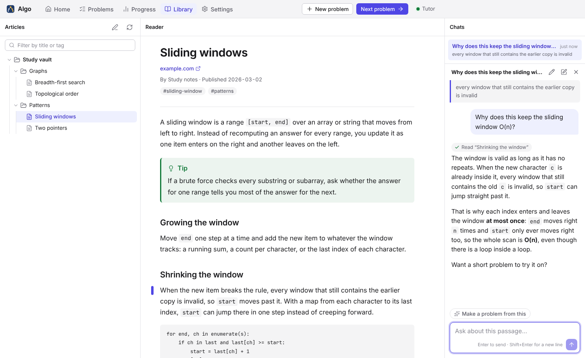

# The Library

The Library is for reading articles you have saved on your computer, offline,
and discussing them with the tutor. You can start several chats on one
article, each tied to the passage it is about.

## Adding articles

The Library reads **Markdown folders you choose**, typically an
[Obsidian](https://obsidian.md) vault (or part of one) filled by the
[Obsidian Web Clipper](https://obsidian.md/clipper). The app reads these
folders and **never writes to them** or fetches web pages: clipping is your
browser's job.

1. Open **Settings → Library** and click **Add folder…**.
2. Open **Library** in the title bar. The left pane shows your folders and
   articles. Type in the filter box to search by title or tag.

The Library notices new and changed files while it is open; **Refresh** (the
circular-arrows button at the top of the Articles pane) rescans by hand.
Click a folder to fold or unfold it. Hidden folders (`.obsidian`, `.trash`, `.git`) and files
over 5 MB are skipped. A file's YAML frontmatter (`title`, `source`,
`author`, `published`, `tags`, ...) is shown above the article.

**Remove…** next to a folder in Settings removes it from the Library, along
with the chats on its articles (after a confirm). Its files are never
touched.

## Reading

Articles render as Markdown with the Obsidian syntax clippers produce:
`![[image.png]]` embeds, `[[links]]` between notes in your library, and
`> [!note]` callouts. Links to websites open in your browser. For safety,
raw HTML inside a note is dropped, so some clipped formatting may be lost.

**Images** in the folder are shown directly. Images linked from a website are
downloaded once, by the app, and kept in a cache so the article then works
offline:

- **Images an article links to**, in **Settings → Library**, chooses whether
  they download when you open an article (the default) or only after you
  click **Load images**.
- **Make available offline** on a folder downloads every article's images.
- A placeholder says why an image was not shown; **Retry** tries again.
- **Settings → Library** shows the cache size and can **Clear** it.

Image downloads are restricted: `https` only, never to your local network,
with size and time limits. The page itself never contacts a website.

## Listening to an article

**Read aloud** (the speaker button in the Reader's header) reads the
article to you with **Kokoro**, an open-source neural voice that runs on
your computer. It starts at the top, or at the paragraph you have selected
text in. The paragraph being read is highlighted and kept in view; code
blocks and images are skipped.

The first time, the app offers to download the voice: 326 MB, once, from
Hugging Face, along with eSpeak NG, a small open-source program that tells
the voice how words are pronounced (it comes as a separate download
because it has a different licence from Algo's). After that, reading aloud works offline and nothing you read
leaves your computer. The first paragraph takes a little longer while the
voice starts. It runs on the processor (CPU). If your computer has a
graphics card, **Use the GPU** in **Settings → Library** runs it there
instead, which is often faster; if the card can't be used it stays on the
CPU and says so. **Settings → Library** shows where it runs and how fast,
and has **Remove** to delete the download.

While it reads, a bar at the bottom of the reader has **Previous
paragraph**, **Pause**/**Resume** (it pauses mid-sentence), **Next
paragraph**, where it is, the **speed** (0.75× to 2×), the **voice** (28
American and British English voices; Heart is the default) and **Stop**.
Speed and voice are remembered on this computer. Opening another article
or leaving the Library stops it. With the
[leader key](getting-started.md), `p` starts, pauses and resumes, `n` and
`b` move a paragraph forward and back, and `x` stops.

## Chatting about a passage

Select some text and click **Ask about this**, or use the **Ask** button
that appears when you point at a heading (it is also in the Tab order). The
chat pane on the right opens a new conversation tied to that passage, with
the cursor in its question box, and a marker appears in the margin beside it.

- Each article can have many chats. The list at the top of the chat pane
  shows them with their passage and how long ago they were last used (point
  at the time for the full date); click a margin marker or a list entry to
  reopen one. The buttons above an open chat are **Rename** (a better
  title), **New chat** and **Close**.
- The tutor sees the article's title and outline and the section you asked
  about. It can read other sections or search the article when it needs to,
  but nothing outside it.
- **Make a problem from this** asks the tutor for a practice problem based on
  the passage. As with every new problem, it appears only if it passes its
  self-check, and **Open in Practice** takes you to it.
- If the article file changes, chats stay attached to their passage. If the
  passage is gone, the chat is listed as detached; if the file is gone, the
  article shows "file missing" and its chats remain until you delete them.

The first time you send a message about an article, the app tells you that
the passage and outline are sent to the tutor's provider. Reading, and
reading aloud, never send anything.

## Articles written by the tutor

**Write an article** (the pen button at the top of the Articles pane) asks
the tutor for an article on a topic, at a level
(beginner, intermediate or advanced) and length you choose. Tutor-written
articles are saved in the app's own data folder, not in your folders, are
listed under **Written by the tutor**, and are labelled as AI-written. They
are included when you [export your data](data-and-privacy.md#export-import-and-reset).
