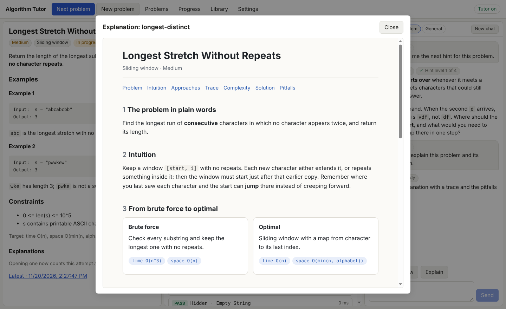

# The tutor

The tutor is an AI model (Claude, from Anthropic) that can see the problem,
read your code, run the tests and talk you through it. It gives hints one
level at a time, reviews your solution, writes explanation pages, makes new
problems and discusses the articles in your [Library](library.md).

It is optional: browsing, editing, running, submitting, progress and reading
all work without it.

## Connecting the tutor

The tutor needs an [Anthropic API key](https://console.anthropic.com/settings/keys)
(usage is billed to your Anthropic account).

1. Open **Settings → Tutor**, paste the key into **Anthropic API key** and
   save. It is encrypted with your OS keychain (macOS Keychain, Windows
   DPAPI, the Secret Service on Linux) and shown back only as "ends in
   …abcd". **Test connection** makes one small request to check it.
2. Pick a **backend**:
   - **Automatic** (default) uses the Anthropic API when a key is set.
   - **Anthropic API** always uses it.
   - **Claude Code (with your API key)** uses your installed
     [Claude Code](https://docs.anthropic.com/en/docs/claude-code) (2.1.328 or
     later) as the tutor, still with the API key above: the app cannot use a
     Claude subscription login. The app finds `claude` on your `PATH`, or you
     can give its path. Claude Code runs with all of its own tools off and
     only the tutor's tools on.
   - **Off** turns the tutor off.
3. Optionally set the **model** and **effort**.

The tutor chat then appears in the practice view with **Hint**, **Review**
and **Explain**, and **New problem** can generate, paste or import problems.

If `ANTHROPIC_API_KEY` is set in the environment the app starts in, it is
used instead of a stored key and is read-only in Settings.

On Linux without a keyring (no GNOME Keyring or KWallet running), the key can
only be stored with weak protection; Settings warns you when that is the case.

## What the tutor does

| | |
|---|---|
| **Chat** | Each problem has its own conversation (**This problem**), next to a **General** one. Conversations are kept; **New chat** starts afresh. |
| **Hint** | One level at a time, four levels from a nudge to a near-solution. The tutor reads your code first, so the hint fits where you are. |
| **Review** | Runs the tests, then reviews correctness, complexity, edge cases and readability. |
| **Explain** | Opens a full explanation page for the problem: plain words, intuition, brute force to optimal, a step-by-step trace, complexity, a solution and pitfalls. |
| **What next?** | From the home screen, picks your next problem and opens it. |
| **New problem** | Generates, converts or imports a problem; it appears only if its reference passes its own tests. |

## What the tutor cannot do

The tutor has a fixed set of tools. It cannot write into your solution file,
open other files, run commands or reach the network. Code it writes for new
problems runs only in the sandboxed in-app Python. Pass or fail always comes
from running the tests, never from what the model says.

See [Privacy](data-and-privacy.md#privacy-what-the-tutor-sees) for exactly
what is sent to Anthropic.
